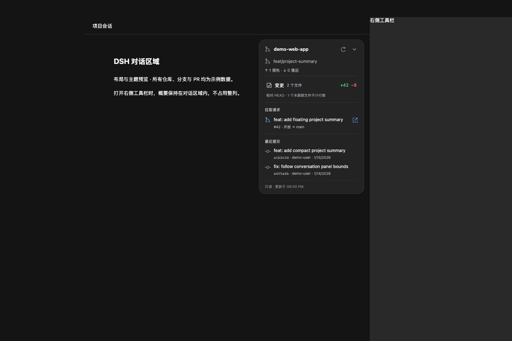
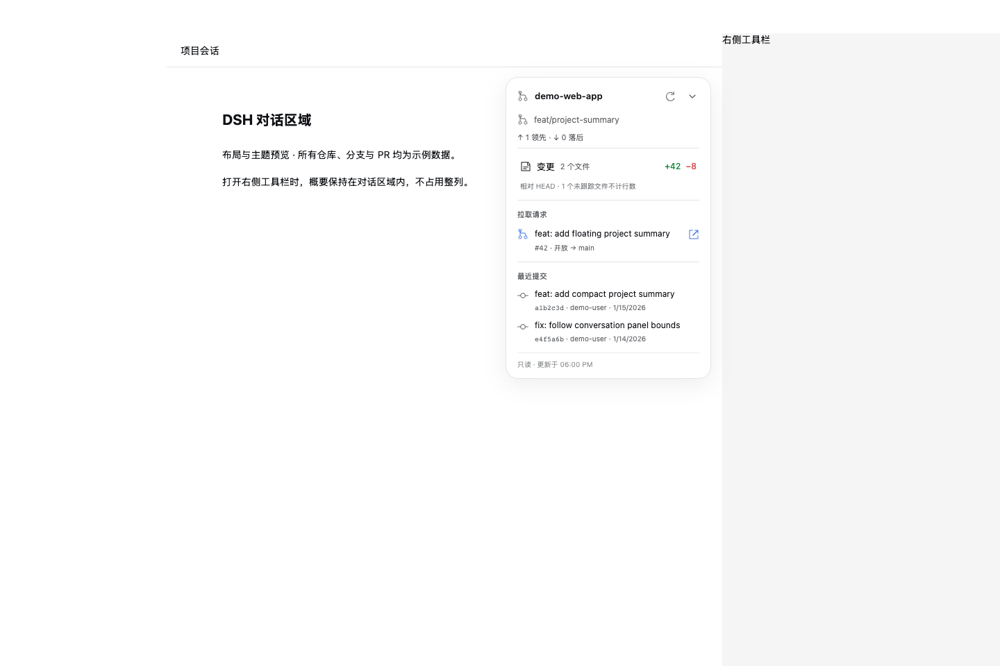

# DSH Project Summary

**在 DeepSeek Harness 对话窗口中，用一张悬浮卡片查看分支、变更、提交和 PR。**

[](https://github.com/callqh/dsh-project-summary/actions/workflows/ci.yml)
[](LICENSE)
[](https://github.com/callqh/dsh-project-summary/releases)

简体中文 · [English](README.en.md)

一个第三方、只读的 DSH 插件。概要悬浮在**当前对话区域的右上角**，不占用整列、不替换现有右侧栏。侧栏打开、关闭或调整宽度时，卡片跟随对话区域移动；背景、文字和边框直接继承 DSH 客户端的深浅主题。

> 初始适配版本：**DSH `0.2.0-rc.2`**。实际集成基于 macOS 桌面版；其他 DSH 版本和 Windows 尚未验证。开发测试可在 Linux CI 中运行。本项目与 DeepSeek / OpenAI 无官方关联，界面文案目前为中文。

## 预览

| 深色主题 · 右侧栏已打开 | 浅色主题 · 右侧栏已打开 |
| --- | --- |
|  |  |

*以上为组件演示截图，使用模拟布局、主题变量和虚构仓库 / PR 数据，不是真实会话截图。实际内容来自当前项目。*

## 功能

- **项目与分支**：仓库名称、当前分支、游离 HEAD，以及相对本地 upstream 的领先 / 落后提交数。
- **工作区变更**：修改文件数、增加 / 删除行数；点击「变更」打开只读 diff 预览。
- **拉取请求**：GitHub 当前分支关联的 PR 标题、编号、状态、目标分支和外链，优先显示开放 PR。
- **最近提交**：最近三条提交的短 hash、说明、作者和日期。
- **轻量悬浮**：展开宽度约 296px，可收起；记住收起状态，窄屏初次打开默认收起。
- **主题与布局**：自动跟随 DSH 深浅主题；概要留在对话区域，不覆盖右侧工具栏。
- **自动刷新**：展开时每 15 秒查询本地 Git；PR 缓存 60 秒；页面不可见时暂停读取。
- **只读与降级**：不提交、不推送、不切分支、不初始化仓库。没有 Git 仓库、没有 PR 或 gh 不可用时显示提示。

## 快速安装

### 1. 下载预构建插件

前往 [GitHub Releases](https://github.com/callqh/dsh-project-summary/releases/latest)，下载：

```text
dsh-project-summary-0.1.1.tgz
```

发布包已包含 Host 与 Client 构建产物，**无需允许运行安装脚本**。

### 2. 通过 DSH 插件管理器安装并启用

在 DSH 中向 Agent 发送：

```text
请用 plugin_manager 安装并启用这个插件 bundle：
https://github.com/callqh/dsh-project-summary/releases/download/v0.1.1/dsh-project-summary-0.1.1.tgz
```

如果你已经下载到本地，也可以提供 tarball 的绝对路径。对应工具参数示例：

```json
{
  "action": "install_bundle",
  "target": "https://github.com/callqh/dsh-project-summary/releases/download/v0.1.1/dsh-project-summary-0.1.1.tgz",
  "enabled": true
}
```

这是 **DSH 工具参数**，不是终端命令。根据当前权限设置，DSH 可能要求批准。安装和启用会影响当前 profile 下的所有会话。

### 3. 加载新版本

按插件管理器返回的结果操作：

- `applied`：刷新当前 DSH 页面，让新的 Client bundle 加载。
- `restart-required`：**退出并重新打开 DSH**，仅刷新页面可能仍然使用旧版本。

打开使用 Git 仓库目录的主会话即可看到概要。插件没有额外必填配置，不会修改 DSH 原有侧栏。

> npm registry 暂未发布；请使用 GitHub Release tarball，不要直接运行 `npm install dsh-project-summary`。

## 可选：显示 GitHub PR

本地分支、变更与提交只需要 `git`。PR 查询额外需要安装 [GitHub CLI](https://cli.github.com/)，并在 **DSH Host 所使用的环境**中完成登录：

```bash
gh auth login
gh auth status
```

插件只查询 `origin` 指向的 **GitHub.com** 仓库，支持 HTTPS、`git@github.com:` 和 `ssh://git@github.com/` 地址。支持开放、已合并和已关闭 PR；多个匹配结果中优先选开放 PR。暂不支持 GitLab、GitHub Enterprise 或自定义远程名称。

缺少 gh、未登录、权限不足或网络不可用时，PR 区域显示提示，**不影响本地 Git 信息**。插件不会触发登录，也不会读取或展示 token。

## 统计口径与限制

| 内容 | 口径 |
| --- | --- |
| 当前项目 | 已载入主会话的 Host 工作目录；沿父目录查找 Git 仓库 |
| 变更行数 | 相对 `HEAD` 的最终工作区内容，包含已暂存和未暂存修改；不是本次 AI 回合的修改量 |
| 未跟踪文件 | 仅显示名称，不读取内容、不计行数；未跟踪目录按 Git `--untracked-files=normal` 的汇总显示 |
| 尚无提交 | 显示已暂存修改；提交记录为空 |
| 二进制文件 | 单独计数，不按文本行统计 |
| 领先 / 落后 | 对比本地已知 upstream；不会自动 `fetch`，无 upstream 时为 0 |
| Diff 预览 | 已跟踪文件，最多 100,000 字符；不含未跟踪文件内容 |
| 大仓库 | 单次命令最多 8 秒、输出最多 2 MB，超限时提示失败 |
| 刷新 | 本地概要有 4 秒短缓存；PR 最多每分钟查询一次，手动刷新同样遵守 PR 缓存 |

## 安全与隐私

- 不使用 shell 拼接执行命令；只运行固定的只读 Git / gh 查询。
- Git 读取关闭 fsmonitor、hooks、外部 diff、textconv、pager 和 optional locks。
- 浏览器只传会话 ID，不接受任意磁盘路径。
- 无遥测、独立数据库或凭据存储；localStorage 只记住卡片收起状态。
- 安装意味着信任 Host 插件读取项目及使用现有 gh 凭据联网查询，**不等于为不可信仓库提供沙箱**。

完整说明与私密漏洞报告方式见 [安全策略](SECURITY.md)。请勿将真实 token、私有仓库内容或未脱敏日志提交到公开 Issue。

## 常见问题

**安装后没有卡片？** 先检查是否已启用，是否需要重启，是否处于已有工作目录的主会话。设置页不会展示卡片；不兼容 DSH 版本可能缺少所需的 Slot 或布局标记。

**打开右侧栏会挡住概要吗？** 概要根据对话区域的实际边界定位，不按整个窗口的右边缘定位。它不占用整列；狭窄窗口可收起卡片。

**切换系统主题没有变化？** 卡片跟随的是 **DSH 当前主题**，不是独立监听系统主题。当 DSH 选择「跟随系统」时，概要也随 DSH 一起切换。

**为什么没有关联 PR？** 检查 `origin` 是否为 GitHub.com、当前分支是否有 PR，以及 DSH Host 环境中的 `gh auth status`。PR 缓存最多保留一分钟。

**怎么停用 / 卸载？** 通过 DSH 插件管理器对 `dsh-project-summary` 执行 `set_bundle`（`enabled: false`）或 `remove_bundle`。按返回结果刷新或重启。

## 开发与贡献

需要 Node.js **22.18+** 和 Git，无需另一个 DSH 项目提供依赖：

```bash
git clone https://github.com/callqh/dsh-project-summary.git
cd dsh-project-summary
npm ci --ignore-scripts
npm run check
npx playwright install chromium
npm run test:ui
npm pack --ignore-scripts
```

`npm run check` 包含类型检查、构建、Git 测试和发布包检查。UI 测试使用模拟 RPC / 主题 / 布局，不启动新的 DSH 服务、不改动用户 profile。源代码及预构建产物均在仓库中。

欢迎提交 [Issue](https://github.com/callqh/dsh-project-summary/issues) 或 Pull Request。目录结构和贡献规范见 [CONTRIBUTING.md](CONTRIBUTING.md)，版本记录见 [CHANGELOG.md](CHANGELOG.md)。

## 许可证

[MIT](LICENSE) © 2026 callqh。可以使用、修改和再分发；请保留许可证声明。
